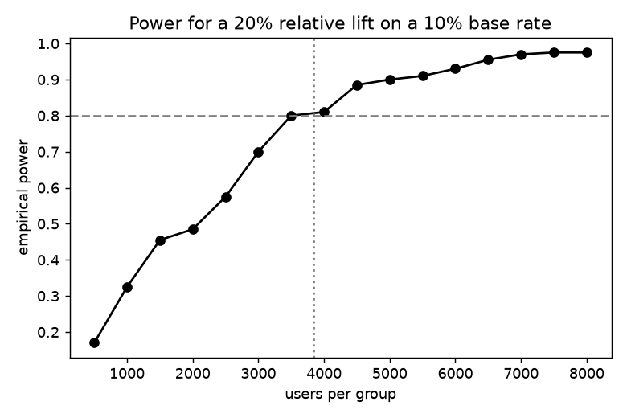

# ab-test-toolkit

Small library for analysing online experiments: z-test, Welch t-test, bootstrap, sample size, SRM check, CUPED.

## Task

Cover the statistics around an A/B test and verify them by simulation instead of trusting the formulas blindly.

## Approach

- `two_proportion_ztest`, `welch_ttest` and `bootstrap_diff` return the difference, a confidence interval and a p-value in one object.
- `sample_size_per_group` gives the required sample for an absolute lift; `srm_check` flags broken traffic splits; `cuped_adjust` reduces variance with a pre-experiment metric.
- `run.py` checks the tools empirically: false positive rate on A/A tests, power at the computed sample size and a power curve.

## Results



- Detecting +2 points on a 10% base rate needs 3,839 users per group; simulated power at that size is 79%.
- False positive rate in 1000 A/A tests: 4.3% (nominal 5%).
- On skewed revenue data the Welch test gives p = 2.45e-05 and the bootstrap interval for the lift is [1.38, 3.79].
- CUPED narrows the confidence interval by 28%.

## Run

```bash
pip install -r requirements.txt
python run.py      # generates data, runs the analysis, writes reports/
pytest             # unit tests
```

## Layout

```
src/data.py     data generation (fixed seed, no downloads)
src/core.py     analysis / model code
run.py          end-to-end script
tests/          unit tests
reports/        figures and summary.json produced by run.py
```

## Notes

The data is generated by `src/data.py` with a fixed random seed, so the numbers above are reproducible. It is synthetic: it is meant to show the method, and results on real data will differ.

Stack: numpy, scipy, matplotlib.
